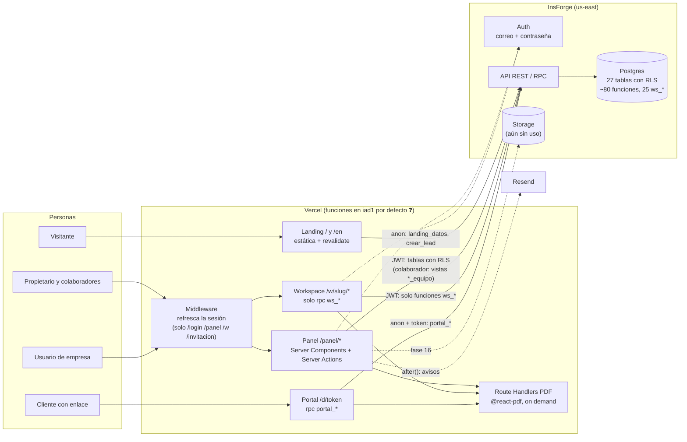

# Evaluación de arquitectura — aguemar Studio

> **Fecha:** 19/10/2026 · **Estado evaluado:** `main` en `1fbaa17` (fases 1–14 cerradas) · **Alcance:** el sistema actual, para un solo negocio con menos de 50 empresas en 12–24 meses.
> Complementa a `AUDITORIA.md` (16/10, commit `c81d9b4`) y a `PLAN-AUDITORIA.md`: no repite sus hallazgos; dice cuáles siguen abiertos y añade los que la auditoría no vio.
> Certeza: ✅ verificado en el código · ⚠️ probable · ❓ hay que mirarlo fuera del repo.
> **Actualizado el 20/10/2026:** lo aplicado de la fase 14.5 y lo pendiente está en la §6.

---

## 0. Requisitos confirmados

| Tipo | Requisito |
|---|---|
| Funcionales | Landing bilingüe que capta leads · panel del propietario y de los colaboradores (empresas, trabajos, calendario, documentos PDF, cotizaciones que crean trabajos, cobros, bandeja, equipo) · workspace por empresa con módulos · portal sin login por token · avisos por correo |
| No funcionales | **Aislamiento entre empresas** (lo más importante) · integridad de lo que una empresa acepta (cotizaciones, actas) · latencia aceptable desde Perú · costo bajo · disponibilidad de negocio pequeño (horas de caída son tolerables; **perder datos no**) · Ley 29733 |
| Restricciones | Una persona construye y opera el sistema (con Claude) · stack en producción: Next.js 15 + InsForge + Vercel · sin Docker · escala: un propietario y menos de 50 empresas |
| Abierto | Comprobantes (fase 16): adjuntarlos o emitirlos. Se decide en el ADR-08 |

---

## 1. Resumen ejecutivo

**El veredicto: la arquitectura es la correcta para este negocio y no hay que cambiarla.** Es un **monolito modular serverless** (Next.js en Vercel) sobre un **BaaS Postgres** (InsForge), y la base de datos hace de capa de autorización y de dominio. Para un desarrollador y menos de 50 empresas es lo más simple que cumple los requisitos. Microservicios, colas, una API propia, Redis o multi-propietario serían sobre-diseño puro. La fase 13 cerró la causa raíz de los tres hallazgos graves de la auditoría (no existía el "propietario") y la fase 12 trajo CI y staging. Hoy la seguridad del modelo es buena.

Los riesgos que quedan ya no son de diseño. Son de **operación y de integridad de datos**:

1. 🔴 **No hay una red probada contra la pérdida de datos.** InsForge es el único lugar donde viven los datos de tus clientes. No sabemos si tiene PITR y nunca se probó una restauración. Es el punto único de fallo que más importa. ❓
2. 🟠 **Lo que una empresa acepta puede cambiar después de aceptado.** El PDF de una cotización aceptada se arma en vivo con los datos actuales: si cambias "Mi marca" (RUC, cuentas de pago), cambia también. El bloqueo de edición solo existe en la Server Action, no en la base. Una cotización *enviada* se puede editar sin dejar rastro de qué versión vio el cliente. ✅
3. 🟠 **Dependencia de un proveedor joven** (InsForge, SDK 1.x) para la base, la auth y pronto el storage. No es motivo para migrar, pero sí para tener un plan de salida barato. ⚠️
4. 🟡 **Ceguera operativa.** No hay alertas de errores ni de caídas, y los avisos de leads pueden fallar sin que nadie se entere (DEV-03 y CON-02 siguen abiertos). ✅

**Recomendación:** antes de seguir con las fases 15 y 16 tal como están en el plan, dedica unos **3 días a una "fase 14.5"**: respaldos verificados, inmutabilidad de lo aceptado y alertas mínimas. Después, comprobantes **adjuntos** (no emitidos) sobre Storage privado.

---

## 2. Diagrama de componentes

**Flujo de datos y fronteras de confianza.** El navegador nunca habla con la base. Todo pasa por el servidor de Next con el JWT del usuario, y **la base decide qué ve cada quien**:

| Actor | Frontera | Barrera |
|---|---|---|
| Propietario | tablas | RLS `owner_id = auth.uid() and es_propietario()` |
| Colaborador | tablas acotadas a `miembro_empresas` y vistas sin montos | 50 políticas `_colaborador_*` y el trigger `_dueno` |
| Empresa | **ninguna tabla** | funciones `security definer` `ws_*` que resuelven la empresa desde `auth.uid()` |
| Anónimo | landing, lead, portal | `landing_datos`, `crear_lead` (con tope), `portal_*` por token de 256 bits |

---

## 3. Decisiones (ADRs)

Los ADR-01 a ADR-05 documentan lo que ya se decidió y lo **ratifican**. Del ADR-06 al ADR-09 son decisiones nuevas.

### ADR-01 · Monolito modular en Next.js, sin API propia — ✅ Mantener

- **Contexto.** Una persona, tres caras (landing, panel, workspace) y lógica compartida (documentos, PDF, formatos).
- **Decisión.** Una sola app Next.js con App Router. Los módulos se separan por carpeta (`src/lib/datos/*`, `acciones.ts` por módulo). Server Actions en vez de endpoints REST.
- **Alternativas.** (a) SPA + API propia (Express/Nest): el doble de superficie y de despliegues, sin beneficio a esta escala. (b) Microservicios: absurdo con un desarrollador y 50 clientes. (c) Apps separadas para panel y workspace: duplicarían la autenticación, los documentos y los PDF.
- **Consecuencias.** + Un solo despliegue, tipos compartidos y refactor barato. − La landing comparte bundle y build con el panel; un error de build tumba todo junto (lo mitiga el CI). − Las Server Actions acoplan la UI a la lógica: si un día necesitas una app móvil o integraciones, harán falta Route Handlers. No lo construyas antes.

### ADR-02 · InsForge como BaaS (Postgres + Auth + Storage) — ✅ Mantener, con plan de salida

- **Contexto.** No hay Docker local, hay un solo desarrollador y hace falta auth, base y archivos sin operar servidores.
- **Decisión.** InsForge, con todo el esquema en migraciones SQL y una rama `staging`.
- **Alternativas.** (a) **Supabase**: el equivalente más maduro, con región São Paulo, PITR documentado y tipos generados. Era la opción más segura al empezar. Migrar hoy cuesta días (auth, `auth.uid()`, CLI) y no resuelve ningún problema que tengas *hoy*. (b) Neon + Auth.js + S3: más piezas que operar. (c) Postgres propio: imposible sin ops.
- **Consecuencias.** + Cero operación y RLS nativa. − **Lock-in moderado**: el esquema es Postgres estándar y portable; lo que ata es `auth.users`, `auth.uid()`, el SDK y la CLI. − Proveedor joven: cambios del SDK y disponibilidad sin historial.
- **Plan de salida (barato, hazlo ya):** export semanal de la base fuera de InsForge (ADR-06), nada de lógica que dependa de tablas internas de InsForge (hoy `ws_admin_set_password` escribe en `auth.users`: hay que retirarla, DAT-02) y el SDK solo detrás de `src/lib/insforge/*`, como ya está.
- **Disparadores para reconsiderar:** una caída de más de 4 h, que no haya PITR, una subida de precio o un SDK que rompa en una versión menor.

### ADR-03 · La base de datos es la barrera de autorización — ✅ Mantener

- **Contexto.** El requisito número uno es que una empresa no vea lo de otra, y lo construye una persona que a veces escribe código con prisa.
- **Decisión.** RLS en todas las tablas para el propietario y el colaborador. La empresa no tiene políticas: solo funciones `ws_*` `security definer` con `search_path` fijo y proyección de columnas seguras. La app no repite los chequeos, salvo `exigirPropietario()` donde la RLS no llega.
- **Alternativas.** Autorización en la capa de Next (middleware o servicios): un solo `where` olvidado expondría datos de otra empresa.
- **Consecuencias.** + Un error en la UI no filtra datos. + `seguridad.spec.ts` y `equipo.spec.ts` prueban los vectores. − **Toda la seguridad depende de que las ~80 funciones estén bien.** Una `security definer` nueva sin filtro por empresa abre un agujero que ninguna capa detecta. Por eso los tests de SQL (ADR-09) dejan de ser opcionales. − La lógica de las políticas es difícil de leer a mano. Los generadores (`scripts/generar-*.mjs`) ayudan; úsalos siempre.

### ADR-04 · La lógica de dinero y documentos vive en SQL — ✅ Mantener, con deuda reconocida

- **Contexto.** Totales con IGV, numeración `COT-AAAA-NNN` y "aceptar crea el trabajo" tienen que ser atómicos y no duplicarse.
- **Decisión.** Triggers para los totales, `asignar_numero` atómico por upsert, `cotizacion_aceptar_core` con `for update`, y las proyecciones `*_json` compartidas por panel, workspace y portal.
- **Alternativas.** Lógica en TypeScript con transacciones desde el cliente: el SDK REST no da transacciones multi-tabla, así que habría condiciones de carrera.
- **Consecuencias.** + Consistencia garantizada y una sola forma de cada documento. − **Deuda (ARQ-02, abierta):** `portal_documento` se redefinió 4 veces y `panel_resumen` 3. Para saber qué versión rige hay que leer las 22 migraciones en orden. − **Deuda (ARQ-03, abierta):** los tipos son manuales y hay 96 `data as X` sin validar: un cambio de columna no rompe la compilación.
- **Acción:** un script `npm run db:funciones` que vuelque `pg_get_functiondef` de staging a `db/funciones/*.sql` (solo lectura, para revisar en el diff). Zod en las lecturas del workspace y del portal, que son las que ve el cliente.

### ADR-05 · Esquema con `owner_id` y negocio de un solo propietario — ✅ Mantener, no construir SaaS

- **Contexto.** Todas las tablas llevan `owner_id`, pero el negocio tiene un único propietario y no se venderá como SaaS en 24 meses.
- **Decisión.** Conservar `owner_id` (protegido por `columnas_sistema()`). No invertir nada en multi-propietario: ni onboarding de dueños, ni facturación propia, ni aislamiento por esquema.
- **Alternativas.** (a) Quitar `owner_id`: una migración grande y arriesgada para ahorrar nada. (b) Preparar ya el SaaS: meses de trabajo para un mercado que no está validado.
- **Consecuencias.** `owner_id` es hoy casi redundante, pero barato, y deja la puerta abierta si algún día cambia el negocio. `propietario_id()` asume un único propietario; está bien, pero queda escrito aquí que es una decisión, no un descuido.

### ADR-06 · Respaldos propios y prueba de restauración — 🆕 Hacer ya

- **Contexto.** InsForge guarda los únicos datos de tus clientes. No está verificado si hay backups automáticos ni PITR (DAT-04 ❓). `_respaldos/` guarda volcados con datos personales sin cifrar en tu equipo.
- **Decisión.**
  1. Verifica en el panel de InsForge qué respaldo ofrece tu plan (frecuencia, retención, PITR) y anótalo en el README.
  2. Haz un export semanal propio con la CLI (`insforge` tiene import/export) a un destino cifrado fuera de InsForge, por ejemplo una carpeta con BitLocker y una copia en tu nube. Empieza con un recordatorio semanal; no metas credenciales de producción en GitHub Actions por ahora.
  3. **Simulacro de restauración** una vez por trimestre: importa el export a una rama desechable y comprueba que el inicio del panel carga.
  4. Cifra o borra `_respaldos/`.
- **Alternativas.** Confiar solo en el proveedor: es aceptable *si* hay PITR, pero no te protege de un error tuyo (una migración destructiva o un `delete` equivocado) que se replica en los backups. Un backup automático en CI: más cómodo, pero pone la clave de la base de producción en GitHub; para un negocio de este tamaño, un proceso manual y disciplinado es más seguro.
- **Consecuencias.** RPO de una semana en el peor caso, menos si hay PITR. Unos 15 minutos a la semana.

### ADR-07 · Lo aceptado es inmutable y deja evidencia — 🆕 Hacer antes de comprobantes

- **Contexto.** Una cotización aceptada genera el trabajo y es la base del cobro. Hoy:
  - `cotizacion_json` lee `perfil_marca` en vivo: el PDF de una cotización aceptada cambia si editas tu RUC o tus cuentas (`migrations/20261014221151_cotizaciones-cobros.sql:323`). ✅
  - "Una aceptada no se edita" solo lo hace cumplir `src/app/panel/cotizaciones/acciones.ts:42`, no la base. ✅
  - Una cotización *enviada* se puede editar después de que el cliente la vio, y `aceptaciones` no guarda **qué** se aceptó. ✅
  - Las actas de entrega tienen probablemente el mismo patrón. ⚠️
- **Decisión.**
  1. Trigger en `cotizaciones` y `cotizacion_items` que **rechace cambios** si la cotización está `aceptada`. Además, al editar una `enviada`, que vuelva a `borrador` o suba un número de versión.
  2. Al aceptar, guardar en `aceptaciones` un **snapshot** (`documento jsonb`, el `cotizacion_json` completo con la marca de ese momento) y su `sha256`.
  3. El PDF de un documento aceptado se arma desde el snapshot, no en vivo. Lo mismo para las actas.
- **Alternativas.** Guardar el PDF generado en Storage al aceptar: también sirve, pero el snapshot JSON es más liviano, se puede consultar y regenera un PDF idéntico.
- **Consecuencias.** + Evidencia defendible ante un desacuerdo con el cliente. + Los comprobantes de la fase 16 se anclan a algo que no cambia. − Una migración y ajustes en dos `*_json` y dos PDF (alrededor de 1 día).

### ADR-08 · Comprobantes: adjuntar, no emitir — 🆕 Decisión para la fase 16

- **Contexto.** Todavía no sabes si los comprobantes se adjuntarán o se emitirán. Con menos de 50 empresas, el volumen sería de unos pocos comprobantes al mes.
- **Opciones.**

| | A · Adjuntar (recomendada) | B · Emitir desde la app (vía PSE/OSE, p. ej. Nubefact) |
|---|---|---|
| Qué es | Emites en SUNAT (SOL o tu sistema actual) y subes el PDF y el XML al cobro | La app arma la factura o boleta, la envía al PSE y guarda el XML y el CDR |
| Esfuerzo | ~1,5 días | 2–4 semanas: series, notas de crédito, comunicación de baja, reintentos, conservación del XML y del CDR |
| Riesgo | Bajo: si falla, solo falta un archivo | **Tributario**: un bug emite mal un comprobante legal |
| Costo | Storage | Mensualidad del PSE |
| Cuándo pasar a B | Cuando emitas más de unos 30 comprobantes al mes o el tiempo de emitir a mano te duela | — |

- **Decisión.** **A**, diseñada para que B se pueda añadir sin rehacer nada:
  - Tabla `comprobantes` (`cobro_id`, `tipo` factura/boleta/recibo por honorarios, `serie`, `numero`, `fecha`, `monto`, `archivo_pdf`, `archivo_xml`, `origen` = `manual`|`pse`). El `origen` deja lista la opción B.
  - **Primer uso de Storage, con el mismo modelo de seguridad:** un bucket **privado** al que la empresa no tiene acceso directo. La descarga pasa por un Route Handler que llama a una función `ws_comprobante(id)` (valida la empresa y el módulo) y responde con una URL firmada de vida corta. Nada de buckets públicos ni de rutas adivinables.
  - Confirma con tu contador si emites facturas (RUC 20/10 con 3.ª categoría) o recibos por honorarios (4.ª): cambia los tipos, no la arquitectura. `[PENDIENTE: régimen tributario]`
- **Consecuencias.** La empresa ve su comprobante en Cotizaciones y cobros y en el portal. Tú sigues emitiendo en SUNAT dos minutos por comprobante.

### ADR-09 · Pruebas de la capa SQL contra staging — 🆕 Subir de prioridad

- **Contexto.** El ADR-03 pone toda la seguridad en la base, pero el CI solo corre tests unitarios con mocks. Los e2e existen pero se corren a mano y necesitan `npm run dev` levantado.
- **Decisión.** Una suite de integración en Vitest (`tests/sql/*.node.test.ts`) que llame por RPC a staging con las cuentas de prueba: aislamiento A/B para cada `ws_*`, `cotizacion_aceptar_core` (no duplica el trabajo), numeración concurrente, saldo y la inmutabilidad del ADR-07. Además, una **prueba de inventario**: listar todas las funciones `security definer` y fallar si aparece una sin `search_path` o con `execute` para `anon` que no esté en la lista blanca.
- **Alternativas.** pgTAP: más idiomático, pero exige ejecutar SQL de prueba dentro de la base, y la CLI de InsForge es estricta con eso. Correr los e2e de Playwright en CI contra un preview de Vercel: valioso, pero más frágil y lento. Hazlo después.
- **Consecuencias.** En CI se necesitan los secretos de staging (no de producción): un riesgo aceptable. Cada migración nueva se prueba de verdad antes de llegar a producción.

### ADR-10 · Observabilidad mínima y suficiente — 🆕 Fase 15, recortada

- **Decisión.** (1) **Sentry** (plan gratuito) en server y client, con alerta por correo. Captura los errores de las Server Actions, de los PDF y de `after()`. (2) **Un monitor de uptime gratuito** sobre `/`, `/login` y un `/d/<token-de-prueba>`. (3) **Lead garantizado**: si el aviso de Resend falla, registrarlo y mostrarlo en el inicio del panel ("leads sin contactar > 24 h"). (4) **Vercel Speed Insights** para medir la latencia real en producción *antes* de pensar en regiones (ver R-05).
- **Lo que no hace falta:** OpenTelemetry, logs centralizados, dashboards ni APM. A esta escala son ruido.

---

## 4. Riesgos, puntos únicos de fallo y deuda

| # | Riesgo | Tipo | Prob. | Impacto | Mitigación | Estado |
|---|---|---|---|---|---|---|
| R-01 | Pérdida de datos sin respaldo restaurable | SPOF | Baja | **Crítico** | ADR-06 | ❓ abierto |
| R-02 | Disputa con un cliente por una cotización o acta que cambió después de aceptada | Integridad | Media | Alto | ADR-07 | ✅ abierto |
| R-03 | Una función `ws_*` nueva sin filtro por empresa | Seguridad | Media (crece con cada fase) | Alto | ADR-09 (inventario) y revisar `security definer` en cada PR | abierto |
| R-04 | InsForge cae, cambia precios o rompe el SDK | SPOF / proveedor | Media | Alto | ADR-02 (plan de salida), ADR-06, SDK fijado y Dependabot | parcial |
| R-05 | Latencia en producción. Los 0,35–0,6 s por ida y vuelta se midieron desde Perú directo a us-east. En producción la función de Vercel corre en `iad1` (Virginia, por defecto ❓), junto a la base, así que **cada consulta debería costar milisegundos** y lo lento sería solo un salto del navegador a Vercel. | Rendimiento | — | Medio | Confirma la región de las funciones en Vercel y mide con Speed Insights. **No migres de región sin datos** | ❓ |
| R-06 | Errores en producción que nadie ve (portal, PDF, formulario) | Operación | Alta | Medio | ADR-10 | abierto (DEV-03) |
| R-07 | Lead perdido porque Resend falla en silencio | Negocio | Baja | Medio | ADR-10 (3) | abierto (CON-02) |
| R-08 | Migración aplicada a mano en producción en un orden incompatible con el código publicado | Operación | Baja | Alto | Regla expand/contract ya escrita; añadir una checklist de 3 pasos en el README | parcial |
| R-09 | Registro público abierto en Auth (lo usan las invitaciones vía `signUp`, `src/lib/insforge/admin.ts:16`): cualquiera crea una cuenta. Hoy esa cuenta no ve nada (RLS + `miembros`), pero amplía la superficie de las funciones con `grant … to authenticated` | Seguridad | Baja | Bajo | Cubierto por la prueba de inventario (ADR-09). Si InsForge lo permite, verificación de correo obligatoria ❓ | aceptado |
| R-10 | El PDF serverless (`@react-pdf`) tiene arranque en frío y memoria alta; un documento largo puede rozar el timeout | Rendimiento | Baja | Bajo | Con snapshots (ADR-07) se puede cachear el PDF de lo aceptado | aceptado |
| R-11 | Sesiones vivas hasta que vence el token tras desactivar a alguien (DAT-02) | Seguridad | Baja | Bajo | Ya mitigado: quitar el acceso desvincula al instante en la base | aceptado |

**Deuda técnica previsible**

| Deuda | Interés que cobra | Cuándo pagarla |
|---|---|---|
| Versión vigente de cada función repartida entre migraciones (ARQ-02) | Cada cambio a `portal_documento` o `panel_resumen` es lento y arriesgado | Con el script `db:funciones` (ADR-04) |
| Tipos manuales y 96 `as X` (ARQ-03) | Un cambio de columna rompe en ejecución, no en compilación | Zod en las lecturas de `ws_*` y `portal_*`; el resto, cuando lo toques |
| `ws_admin_set_password` sin uso y escribiendo en `auth.users` | Acopla a la implementación interna de InsForge | Retírala en la próxima migración (5 minutos) |
| Volcados sin cifrar en `_respaldos/` (DAT-04) | Datos personales expuestos si pierdes el equipo | Hoy |
| e2e manuales, fuera del CI | Las regresiones de flujo se descubren tarde | Después del ADR-09 |
| Next 15 → 16 (SEG-10) | Avisos de seguridad acumulados | Cuando Next 16 tenga 2–3 parches; hazlo aparte, sin mezclarlo con funcionalidad |

---

## 5. Roadmap técnico

Considera "MVP técnico" lo que permite **operar con tranquilidad** con los clientes reales que ya tienes. Lo funcional ya está construido.

### Ahora — "Fase 14.5: operar tranquilo" (~3 días)

| # | Qué | ADR | Esfuerzo |
|---|---|---|---|
| 1 | Verificar backups o PITR de InsForge, primer export propio, simulacro de restauración en una rama, cifrar o borrar `_respaldos/` | 06 | ½ día |
| 2 | Inmutabilidad: trigger de bloqueo, snapshot y hash en `aceptaciones`, PDF desde el snapshot (cotizaciones y actas) | 07 | 1 día |
| 3 | Sentry, uptime y aviso de lead garantizado; confirmar la región de Vercel y activar Speed Insights | 10 | ½ día |
| 4 | Tests SQL contra staging en CI (aislamiento, aceptación, numeración, inventario de `security definer`); retirar `ws_admin_set_password` | 09 | 1 día |

### Después — fases 15 y 16, ajustadas

- **Fase 15 (reducida):** analítica sin cookies con los eventos `contacto_enviado` y `whatsapp_click`; CSP con nonces; Turnstile solo si llega spam (el tope de `crear_lead` ya contiene lo grave). Sentry y uptime ya estarán hechos.
- **Fase 16:** comprobantes **adjuntos** (ADR-08) sobre Storage privado con descarga firmada; portafolio en la landing (imágenes públicas en un bucket público *aparte*, nunca mezcladas con los comprobantes).
- **Mantenimiento continuo:** `db:funciones`, Zod en las lecturas del workspace y e2e en CI contra un preview.

### Puede esperar o no hacerse (y por qué)

| Idea | Por qué no ahora |
|---|---|
| Migrar a Supabase u otra región | Sin datos de producción que muestren lentitud; se decide con R-05 medido |
| Emitir comprobantes por PSE | Volumen bajo, riesgo tributario; el disparador está en el ADR-08 |
| Multi-propietario / SaaS | Fuera del alcance a 24 meses (ADR-05) |
| Colas, workers o cron propios | `after()` alcanza para los avisos; si un día hacen falta recordatorios programados, usa las schedules de InsForge o Vercel Cron, no un servicio nuevo |
| Cache (Redis, KV) | Menos de 50 empresas: Postgres responde en milisegundos; el cuello es la red, no la base |
| API pública o app móvil | Nadie la pidió; Server Actions basta |
| Generar todos los tipos o pasar a un ORM | Zod en los bordes críticos da el 80 % del valor con el 10 % del trabajo |

---

## 6. Estado al 20/10/2026 — fase 14.5

| Punto | Estado | Detalle |
|---|---|---|
| R-01 · Respaldos (ADR-06) | 🟡 Parcial | **Verificado:** producción está en el plan gratuito de InsForge, que guarda **un solo respaldo manual** (ocupado por el del 13/10) y no programa respaldos; el archivo más reciente es del 16/10. Hecho: `npm run db:respaldo` (export propio a `_respaldos/` o fuera del repo, nunca commiteado; todas las filas hasta el tope de 10 000 por tabla de la CLI, avisa si se corta) y procedimiento en el README. **No incluye las cuentas (`auth.users`)**: la recuperación completa sigue necesitando el respaldo de InsForge. **Producción, 20/10:** export en `_respaldos/` (32 tablas, 63 filas) y respaldo manual de InsForge renovado (`2026-10-20-antes-fase-14-5`). Pendiente tuyo: copiar los exports fuera del equipo cada cierto tiempo y el primer simulacro de restauración |
| R-02 · Inmutabilidad (ADR-07) | ✅ En producción (20/10) | Migración `inmutabilidad-aceptados`: copia (`documento` / `aceptada_documento`) con huella sha256 al aceptar; `cotizacion_json` y `acta_json` la superponen; triggers que impiden editar o borrar lo aceptado y registrar una aceptación desde la API; las 6 aceptaciones existentes en staging recibieron su copia. El PDF del panel sale de `cotizacion_panel`, la misma proyección que el workspace y el portal |
| R-03 · Funciones `security definer` (ADR-09) | ✅ | `tests/unit/migraciones.node.test.ts` reconstruye desde `migrations/` el estado de las 93 funciones y falla si una `security definer` no fija `search_path`, queda ejecutable por PUBLIC, `anon` llega a algo fuera de las 8 públicas por diseño o una pieza interna (`*_core`, `*_json`…) se expone. Hoy las 71 `security definer` cumplen |
| ADR-09 · Pruebas contra staging en CI | ✅ Listo, falta activarlo | En vez de una suite nueva en Vitest, `seguridad.spec.ts` (que ya era solo API) suma 4 pruebas de inmutabilidad y corre en el job `seguridad` del CI. Se activa cuando cargues los secretos `STAGING_*` y `E2E_*` en GitHub |
| ADR-04 · Funciones vigentes | ✅ | `npm run db:funciones` → `db/funciones/<nombre>.sql`; el test anterior falla si la carpeta queda desactualizada |
| DAT-02 · `ws_admin_set_password` | ✅ En producción (20/10) | Retirada en la misma migración |
| R-07 · Lead garantizado | ✅ (Sprint 1, `4fe32e2`) | `respaldarLead` y aviso por WhatsApp si todo falla |
| ADR-10 · Sentry, uptime, Speed Insights | ⏳ Pendiente | Necesita tus cuentas (Sentry, monitor de uptime) y mirar en Vercel la región de las funciones (R-05) |

**Desvíos respecto a lo propuesto, con motivo**

- **Editar una cotización *enviada* no la devuelve a borrador.** Cambiaría tu flujo de trabajo sin que lo hayas pedido, y la copia ya fija lo que efectivamente se aceptó. Queda una carrera rara: si editas una enviada mientras el cliente la tiene abierta, acepta la versión nueva sin haberla visto. Se cierra pasando la huella vista al aceptar; hazlo solo si te pasa alguna vez.
- **La señal "esto viene del núcleo de aceptación" es `current_user`, no `set_config`**, porque la CLI rechaza cambiar la configuración de sesión en las migraciones. Desde la API `current_user` es `anon` o `authenticated`; dentro de una función `security definer` es su dueño. Las pruebas confirman las dos caras: aceptar por el núcleo funciona y cambiar el estado a mano no.
- **El test del DNI enmascarado (SEG-06) ya no borra su cotización aceptada**: lo aceptado no se borra, así que la crea una vez y la reutiliza.

**Orden para producción:** primero `npm run db:respaldo` de producción, luego la migración (es compatible con el código publicado) y después el push. El PDF nuevo del panel llama a `cotizacion_panel`, que no existe en producción hasta aplicar la migración.
