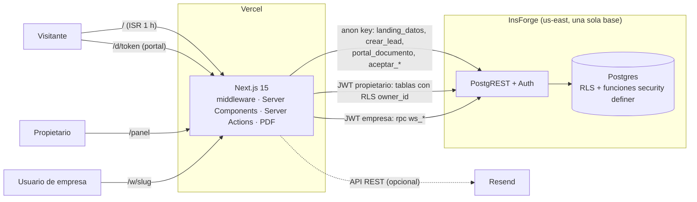

# Auditoría técnica — agueMar Studio

> **Fecha:** 2026-10-16 · **Profundidad:** estándar · **Modo:** solo lectura (todo se instaló y ejecutó en una copia aislada) · **Idioma:** español
> **Commit auditado:** `c81d9b4` (Fase 11) · 21 commits, 1 autor · ~21 000 líneas TS/TSX en `src/` · ~3 500 líneas SQL en `migrations/` (19 migraciones, ~45 funciones)

---

## 1. Resumen ejecutivo

agueMar Studio está **bien construido para su tamaño**: el código tipa y pasa el lint sin errores, los 81 tests unitarios y el build de producción pasan, el diseño es coherente y la base de datos usa RLS, `search_path` fijo y tokens de 256 bits. El problema no está en la calidad del código sino en **quién es "el propietario" dentro de la base de datos**: no existe como concepto protegido. Nota global: **62/100**.

**Tres riesgos más graves**
1. 🔴 **Cualquier persona con una cuenta —incluida cada empresa cliente— puede apropiarse de la landing pública y de los datos de contacto de los prospectos** creando su propio perfil de marca con una fecha antigua (SEG-01).
2. 🟠 **Toma de control de cuentas** (incluida la del propietario) a partir de su UUID, por una validación que se apoya en una fila que el atacante controla (SEG-02).
3. 🟠 **Un solo entorno y ningún filtro antes de producción**: local, tests, migraciones y producción usan la misma base, y cada `push` a `main` se publica sin CI (DEV-01, DEV-02).

**Tres oportunidades más rentables**
1. Cerrar el modelo de propietario con una migración corta (horas) y añadir CI: elimina los riesgos 1–3 y protege los clientes actuales (SGC, BELMANGROUP…).
2. Medir y asegurar la captación: analítica sin cookies, aviso garantizado de cada lead (correo/WhatsApp) y anti-spam real en el formulario (CON-01, CON-02, SEG-04).
3. Páginas por servicio (p. ej. "soporte técnico para empresas en Lima") y política de privacidad: más tráfico orgánico y confianza al dejar datos (SEO-02, LEG-01).

---

## 2. Alcance y método

| Aspecto | Detalle |
|---|---|
| Profundidad | **Estándar**: 12 dimensiones; más detalle en las 5 más relevantes (Seguridad, Datos y backend, Conversión, Arquitectura, DevOps) |
| Aplicaciones cubiertas | 1 (monolito Next.js). No es monorepo |
| Dimensiones N/E | Ninguna. Pero **no se evaluó en ejecución**: rendimiento real (Lighthouse/CWV), accesibilidad con herramienta (axe) ni UX visual en móvil; ver §10 |
| Datos de negocio | Inferidos del repo (`CLAUDE.md`, landing, modelo de datos): *sector* servicios de diseño/desarrollo/soporte técnico; *objetivo* captar leads (landing) y operar clientes (panel + workspace); *mercado* empresas en Perú; *URL* `aguemar.com` (según README/memoria del proyecto, no verificada); *motivo* auditoría general previa a escalar |
| Normativa asumida | Perú: Ley 29733 de Protección de Datos Personales y su reglamento (se recogen nombre, teléfono, correo, DNI e IP). No es dictamen legal |
| Copia aislada | `git clone --local --no-hardlinks` en el directorio temporal de la sesión (`--no-hardlinks` porque el disco rechazó los enlaces duros). Todo `npm`, `tsc`, `eslint`, `vitest` y `next build` se ejecutó ahí |
| Instalación | `npm ci --ignore-scripts`. Solo 2 paquetes tienen script de instalación: `fsevents` (solo macOS) y `unrs-resolver` (binario napi). El build y el lint funcionaron sin ellos |
| Variables de entorno | **No se leyó ningún `.env` real.** Existe un `.env.local` (206 bytes) en disco, ignorado por git y ausente del historial. El build se hizo sin variables (la app lo admite) |

**Comandos ejecutados y resultado:** `npx tsc --noEmit` ✅ sin errores · `npx eslint` ✅ sin avisos · `npx vitest run` ✅ 15 archivos / 81 tests (se revisó antes que solo usan mocks: `fetch` simulado, sin red ni BD) · `npx next build` ✅ (compilación 14,7 s; ~2 min de reloj) · `npm audit` / `npm outdated` · búsquedas de secretos en HEAD e historial.

**Comandos NO ejecutados (con motivo)**
- `npm run test:e2e` (Playwright): exige un servidor corriendo y credenciales reales del propietario y de una empresa, contra la **base de producción compartida** (ver DEV-01). Regla 6/8.
- `db:migrate`, `db:seed`, cualquier consulta SQL contra InsForge: prohibido (regla 8). Las comprobaciones de base de datos se hicieron **leyendo las migraciones**, no ejecutándolas; lo que depende del estado real está en §10.
- Lighthouse: no corresponde a la profundidad estándar.
- `gitleaks`/`trufflehog`: no instalados. Se usó `git log -p --all` con patrones (`sk_live`, `AKIA`, `eyJhbGci`, `re_…`, claves privadas, asignaciones `password=`…) y `git grep` en HEAD. **Resultado: sin secretos** (el único acierto, `re_comercia…`, es texto, no una clave).

---

## 3. Mapa del sistema

**Qué es.** Una sola aplicación Next.js 15 (App Router) con tres caras: **landing pública** (`/`, estática con ISR de 1 h), **panel del propietario** (`/panel/*`) y **workspace por empresa** (`/w/[slug]/*`), más un **portal público por token** (`/d/[token]`) para compartir fichas, cotizaciones, briefs, actas e informes. No hay API propia: el navegador nunca habla con la base; todo pasa por Server Components, Server Actions y Route Handlers (PDF) que llaman a InsForge (Postgres + Auth, alojado en us-east) con el token del usuario. Hosting en Vercel (por README/CLAUDE.md; no hay `vercel.json` ni CI en el repo). **Una única base InsForge sirve a local, tests y producción.**

| Capa | Tecnología / versión |
|---|---|
| Framework | Next.js 15.5.27 (Turbopack en dev), React 19.1.0, TypeScript 5.9.3 estricto |
| UI | Tailwind v4, Radix UI, lucide-react, sonner, next-themes, `next/font` (Sora, JetBrains Mono) |
| Formularios | React Hook Form 7.89 + Zod 4.6 |
| Backend | InsForge (`@insforge/sdk` ^1.5.2): Postgres con RLS, Auth correo+contraseña, funciones SQL `security definer` |
| PDF | `@react-pdf/renderer` 4.9 + `qrcode` en Route Handlers |
| Correo | Resend por API REST (opcional, `after()`) |
| Tests | Vitest 5 (81 unitarios) · Playwright 1.64 (11 specs, manuales y contra datos reales) |
| Tamaños (build) | Landing 165 kB First Load JS · compartido 102 kB · panel 102–206 kB · middleware 87 kB |



**Modelo de acceso (clave para esta auditoría).** El propietario y las empresas son **el mismo rol de base de datos (`authenticated`)**. "Propietario" = *quien tenga una fila en `perfil_marca`* (`src/lib/insforge/server.ts:85-88`); "empresa" = usuario enlazado en `clientes.usuario_id`. Y "el dueño público" (landing, destino de leads) = *el primer `perfil_marca` por `created_at`* (`migrations/20261013171444_funciones.sql:175`, `20261015214414_landing.sql:17`). Las políticas RLS solo comprueban `owner_id = auth.uid()`.

**Hotspots de git** (archivos más tocados, sin contar docs): `src/types/database.ts` (9), `panel/clientes/[id]/page.tsx` (8), `panel/page.tsx` (7), `next.config.ts` (7), `lib/modulos.ts` (6), `lib/datos/workspace.ts` (6), `panel/trabajos/[id]/detalle.tsx` (6), `d/[token]/page.tsx` (6).

---

## 4. Puntuación

| # | Dimensión | Peso | Nota | Justificación |
|---|---|---:|---:|---|
| 1 | Arquitectura | 8 % | **62** | Monolito limpio y adecuado, pero el esquema es multi-propietario y la lógica pública asume un dueño único (ARQ-01, alta) |
| 2 | Calidad del código | 7 % | **80** | `tsc` y `eslint` limpios, sin `any`, convenciones claras; 125 casts sin validar y configuración muerta |
| 3 | Seguridad | 20 % | **38** | 1 crítica (SEG-01) y 2 altas (SEG-02, SEG-04); sin secretos y buenas prácticas de RLS/`search_path` |
| 4 | Rendimiento | 8 % | **76** | Landing estática, bundles pequeños, consultas en paralelo; ISR puede cachear una versión vacía y la latencia a us-east es estructural |
| 5 | SEO técnico | 8 % | **82** | Metadatos, canónica, OG, JSON-LD, sitemap/robots, noindex donde toca; URL base con valor por defecto peligroso y una sola página |
| 6 | Accesibilidad | 5 % | **72** | Semántica y foco presentes; foco (1,64:1) y bordes de campos (1,26:1) bajo el mínimo de contraste (medidos) |
| 7 | UX / Frontend | 5 % | **80** | Esqueletos, estados vacíos, aviso de cambios sin guardar, sistema de diseño propio; no se verificó visualmente |
| 8 | Conversión | 10 % | **66** | Formulario bien resuelto, pero anti-spam evadible (alta, SEG-04), sin medición y avisos de lead opcionales |
| 9 | Datos y backend | 14 % | **62** | SQL cuidadoso en general; columnas de sistema escribibles por cualquier propietario (DAT-01, alta), migraciones sin reversa |
| 10 | Testing | 6 % | **60** | 81 tests útiles en lógica pura; el aislamiento entre empresas, la promesa central, no se prueba entre dos empresas ni en la inserción (TST-01, alta) |
| 11 | DevOps e infraestructura | 6 % | **52** | Sin CI, sin staging, tests y migraciones contra producción, sin monitorización (2 altas) |
| 12 | Analítica y legal | 3 % | **70** | Sin analítica (privacidad por defecto) pero sin política de privacidad ni aviso de tratamiento de datos |
| | **Global (media ponderada)** | 100 % | **62** | Pesos elegidos por el objetivo (captar leads + custodiar datos de clientes): seguridad y datos pesan 34 %, conversión 10 % |

Cálculo: 38·20 + 62·14 + 62·8 + 80·7 + 76·8 + 82·8 + 72·5 + 80·5 + 66·10 + 60·6 + 52·6 + 70·3 = 6 250 → 62,5.

**Recuento de hallazgos:** 🔴 1 · 🟠 7 · 🟡 23 · 🟢 12 (43 en total, en línea con el orden de magnitud del nivel estándar).

---

## 5. Hallazgos detallados

Leyenda de certeza: ✅ verificado en el código · ⚠️ probable (inferido) · ❓ requiere verificación externa. Todos los hallazgos de base de datos se basan en la **lectura de las migraciones**; ninguno se reprodujo contra InsForge.

### 5.1 Seguridad

#### SEG-01 · 🔴 Crítica · Cualquier usuario autenticado puede convertirse en "dueño público" (landing, leads, avisos)
- **Problema.** La landing y el destino de los leads toman como dueño *el perfil de marca más antiguo* (`order by created_at limit 1`). Pero `perfil_marca` puede ser insertada por **cualquier usuario autenticado** (política `owner_id = auth.uid()`, sin más condiciones) y `created_at` es una columna que el cliente puede enviar. Quien inserte un perfil con `created_at = '2000-01-01'` pasa a ser el "dueño".
- **Evidencia.**
  - `migrations/20261013171439_politicas-rls.sql:16-17` (insert permitido a `authenticated` con solo `owner_id = auth.uid()`), `:12` (`grant insert … to authenticated`, a nivel de tabla, incluye `created_at`).
  - `migrations/20261013171444_funciones.sql:175` y `migrations/20261015214414_landing.sql:17`: `order by … created_at limit 1`.
  - `migrations/20261013171433_esquema-base.sql:31-52`: `created_at timestamptz not null default now()` sin trigger que lo fuerce.
  - `src/lib/insforge/server.ts:85-88`: tener una fila en `perfil_marca` ya te convierte en "propietario" y abre `/panel`.
  - `src/lib/correo/avisos.ts` (`correoPropietario`): sin `AVISOS_PARA`, el correo de avisos sale de `landing_datos()` → del mismo "primer perfil".
  - `tests/e2e/seguridad.spec.ts`: no intenta insertar en `perfil_marca` ni en `clientes`.
- **Por qué importa.**
  - *Técnico:* el control de acceso depende de un orden temporal que el atacante puede falsificar. Todos los usuarios de empresa (clientes legítimos con cuenta) ya cumplen la condición previa; si el registro de InsForge está abierto (❓, `src/lib/insforge/admin.ts:16` usa `signUp` con la clave anónima, lo que sugiere que sí), basta cualquier correo.
  - *Negocio:* el atacante recibiría **nombre, teléfono, correo y mensaje de cada prospecto** que escriba por la landing, podría cambiar el teléfono/correo/RUC mostrados en la web (phishing con la marca) y desviar los avisos por correo. Daño reputacional y de datos personales.
- **Solución (código).** Introducir una lista cerrada de propietarios y hacer que todo lo "público" y todo el RLS dependan de ella.

```sql
-- ANTES (20261013171439_politicas-rls.sql)
create policy perfil_marca_insert_propio on public.perfil_marca
  for insert to authenticated with check (owner_id = (select auth.uid()));
-- 20261013171444_funciones.sql:175
select owner_id into v_owner from public.perfil_marca order by created_at limit 1;

-- DESPUÉS (nueva migración)
create table public.propietarios (user_id uuid primary key references auth.users(id) on delete cascade);
alter table public.propietarios enable row level security;      -- sin políticas: no se lee por API
revoke all on public.propietarios from anon, authenticated;
insert into public.propietarios
  select owner_id from public.perfil_marca order by created_at limit 1;   -- el propietario actual

create or replace function public.es_propietario() returns boolean
language sql stable security definer set search_path = pg_catalog, public, pg_temp
as $$ select exists (select 1 from public.propietarios where user_id = auth.uid()) $$;
revoke all on function public.es_propietario() from public, anon;
grant execute on function public.es_propietario() to authenticated;

drop policy perfil_marca_insert_propio on public.perfil_marca;
create policy perfil_marca_insert_propio on public.perfil_marca for insert to authenticated
  with check (owner_id = (select auth.uid()) and public.es_propietario());

-- el dueño público es el propietario registrado, no "el más antiguo"
-- crear_lead / landing_datos:  join public.propietarios o on o.user_id = p.owner_id
-- y un trigger BEFORE INSERT que haga new.created_at := now()
```
  Repetir `and public.es_propietario()` en las políticas del resto de tablas (generable con un script) y que `obtenerRol` use `es_propietario()` en lugar de "tiene `perfil_marca`".
- **Severidad:** 🔴 Crítica · **Impacto:** Alto (datos personales de prospectos y reputación) · **Esfuerzo:** Bajo (horas) · **Responsable:** backend · **Certeza:** ✅ en el SQL; la explotación por terceros ajenos depende del registro abierto ❓ (por usuarios de empresa ya es posible).
- **Acción inmediata de verificación (solo lectura):** `select owner_id, created_at from public.perfil_marca order by created_at;` debe devolver una sola fila (la tuya).

#### SEG-02 · 🟠 Alta · Toma de cuentas por UUID: la validación de `ws_admin_set_password` se apoya en una fila que el atacante crea
- **Problema.** `ws_admin_set_password(p_usuario, p_password)` cambia la contraseña de **cualquier** usuario si existe una fila de `clientes` con `usuario_id = p_usuario` y `owner_id = auth.uid()`. Esa fila la puede crear cualquier autenticado (`clientes_insert_propio`) poniendo como `usuario_id` el UUID de la víctima (el índice único solo impide usar UUIDs ya vinculados; el propietario **no** está vinculado a ninguna empresa). `ws_correo_usuario` tiene el mismo patrón y filtra el correo de cualquier usuario.
- **Evidencia.** `migrations/20261014152859_empresas-workspaces.sql:17` (índice único parcial), `:240` (guarda), `:243` (`update auth.users set password = public.crypt(…)`); `migrations/20261014153517_correo-usuario-empresa.sql:17`; `migrations/20261013171439_politicas-rls.sql:29` (política de insert de `clientes`); `src/app/panel/clientes/acciones.ts:128` (llamada).
- **Por qué importa.** Con el UUID de la víctima (el del propietario viaja en `sub` del JWT de su cookie legible por JS; ver SEG-05) un atacante autenticado fija una contraseña conocida y entra al panel completo. Sin conocer el UUID no es explotable, de ahí "Alta" y no "Crítica"; basta una filtración del UUID para pasar a crítica. Además se escribe directamente en `auth.users` sin revocar sesiones activas (❓, DAT-02).
- **Solución (código).**

```sql
-- ANTES: la guarda confía en una fila controlada por el llamador
if not exists (select 1 from public.clientes c
               where c.usuario_id = p_usuario and c.owner_id = auth.uid()) then raise ...

-- DESPUÉS: (1) solo propietarios, (2) el destino nunca puede ser propietario, (3) usuario_id protegido
create or replace function public.clientes_proteger_usuario() returns trigger
language plpgsql set search_path = pg_catalog, public, pg_temp as $$
begin
  if new.usuario_id is distinct from (case when tg_op = 'UPDATE' then old.usuario_id end) and new.usuario_id is not null then
    if not public.es_propietario()
       or exists (select 1 from public.propietarios where user_id = new.usuario_id)
       or exists (select 1 from public.perfil_marca where owner_id = new.usuario_id) then
      raise exception 'No puedes vincular ese usuario' using errcode = '42501';
    end if;
  end if;
  return new;
end $$;
create trigger clientes_proteger_usuario before insert or update on public.clientes
  for each row execute function public.clientes_proteger_usuario();
-- y en ws_admin_set_password / ws_correo_usuario: agregar `and public.es_propietario()`
-- y rechazar si p_usuario está en public.propietarios
```
- **Severidad:** 🟠 Alta · **Impacto:** Alto · **Esfuerzo:** Bajo · **Responsable:** backend · **Certeza:** ✅ (SQL); explotación requiere UUID de la víctima.

#### SEG-03 · 🟡 Media · Las acciones del panel no comprueban rol: son invocables por cualquier usuario autenticado
- **Problema.** El control "solo propietario" vive en `panel/layout.tsx` (solo afecta a la navegación). Las Server Actions (`'use server'`) y Route Handlers son endpoints POST/GET que cualquier sesión puede llamar. La base limita cada usuario a sus propias filas, pero `crearAccesoEmpresa` llama a `crearUsuarioInsforge` (registro con la clave anónima) y por tanto **un usuario de empresa podría crear cuentas en InsForge** a voluntad.
- **Evidencia.** `src/app/panel/layout.tsx:23-24` (único control), `src/app/panel/clientes/acciones.ts:97-121`, `src/lib/insforge/admin.ts:16`, `src/lib/datos/base.ts` (`conSesion` solo exige sesión).
- **Por qué importa.** Abuso de cuota/spam de cuentas y superficie innecesaria. Se resuelve con `es_propietario()` (SEG-01) y un `exigirPropietario()` común en `conSesion`.
- **Solución:** añadir `exigirPropietario()` (consulta `es_propietario()` una vez por petición con `cache`) y usarlo en acciones y handlers del panel.
- **Severidad:** 🟡 Media · **Impacto:** Medio · **Esfuerzo:** Bajo · **Responsable:** backend/frontend · **Certeza:** ✅

#### SEG-04 · 🟠 Alta · El límite anti-spam de `crear_lead` se evade llamando al RPC con la clave anónima
- **Problema.** El límite (5 por hora e IP) lo calcula la función con un parámetro `p_ip` **que envía el llamador**; si es `null` no hay límite. La clave anónima es pública (`NEXT_PUBLIC_…`), de modo que cualquiera puede invocar `crear_lead` directamente, sin pasar por la Server Action ni por la trampa para bots.
- **Evidencia.** `migrations/20261013171444_funciones.sql:143-160` (parámetros), `:166` (`if p_ip is not null`), `:186-187` (`grant … to anon`); `src/app/acciones.ts:31-39` (la IP la pone la app); el aviso por correo solo se dispara desde la Server Action (`avisos.ts`), por lo que los envíos directos no avisan.
- **Por qué importa.** Un script puede llenar `leads` de basura (o de datos de terceros) sin límite, enterrando leads reales en el panel y llenando la base; la defensa real contra bots es solo un campo trampa (`leadSchema.sitio_web`). Para un negocio cuyo objetivo es captar leads, es el flujo principal.
- **Solución (código).**

```sql
-- ANTES
if p_ip is not null then
  select count(*) into v_recientes from public.leads where ip = p_ip and created_at > now() - interval '1 hour';
  if v_recientes >= 5 then raise exception 'Demasiados envíos…' using errcode = '53400'; end if;
end if;

-- DESPUÉS (opción barata: tope global, que no depende de datos del llamador)
select count(*) into v_recientes from public.leads where created_at > now() - interval '1 hour';
if v_recientes >= 30 then raise exception 'Demasiados envíos…' using errcode = '53400'; end if;
if p_ip is not null and (select count(*) from public.leads where ip = p_ip and created_at > now() - interval '1 hour') >= 5 then
  raise exception 'Demasiados envíos…' using errcode = '53400';
end if;
```
  Opción sólida: `revoke execute on function public.crear_lead(...) from anon` y llamarla desde la Server Action con una clave de servicio (la IP real ya sale de `x-forwarded-for` en Vercel), más un desafío tipo Cloudflare Turnstile. Añadir límites de longitud en SQL (hoy solo en Zod).
- **Severidad:** 🟠 Alta · **Impacto:** Alto (flujo principal de captación) · **Esfuerzo:** Bajo-Medio · **Responsable:** backend · **Certeza:** ✅

#### SEG-05 · 🟡 Media · Sin CSP y con el token de acceso en una cookie legible por JavaScript
- **Problema.** El SDK emite el token de acceso con `httpOnly: false` (lo lee el cliente de navegador). `next.config.ts` define cuatro cabeceras pero **ninguna `Content-Security-Policy`**. Cualquier XSS (no se halló ninguno: el único `dangerouslySetInnerHTML` es el JSON-LD, con `<` escapado) permitiría robar sesiones.
- **Evidencia.** `node_modules/@insforge/sdk/dist/ssr/middleware.js:119-125` (`httpOnly: false` para el access token), `next.config.ts:7-12`, `src/app/page.tsx:309`.
- **Por qué importa.** Defensa en profundidad: el token expone también el UUID (insumo de SEG-02). HSTS lo pone Vercel en el dominio (❓ verificar en producción).
- **Solución:** añadir CSP con nonces (o `default-src 'self'` más lista de orígenes: InsForge, Resend no, fuentes self-hosted por `next/font`), `frame-ancestors 'none'` (hoy solo `X-Frame-Options`), y comprobar con `curl -I`.
- **Severidad:** 🟡 Media · **Impacto:** Medio · **Esfuerzo:** Medio · **Responsable:** frontend/DevOps · **Certeza:** ✅ (ausencia de CSP) / ❓ (cabeceras reales en producción)

#### SEG-06 · 🟡 Media · Aceptación pública con solo nombre + DNI tecleado, y DNI visible para quien tenga el enlace
- **Problema.** `aceptar_cotizacion` / `aceptar_acta` crean trabajo y marcan entrega con cualquier nombre y 8 dígitos, sin verificar identidad. Además `cotizacion_json` devuelve el DNI **completo** de quien aceptó dentro del portal.
- **Evidencia.** `migrations/20261014221151_cotizaciones-cobros.sql:126-200` (núcleo), `migrations/20261015150431_fichas-portal.sql` (`'aceptacion' → 'dni', a.dni` en `cotizacion_json`), `src/app/d/[token]/acciones.ts:11-14`.
- **Por qué importa.** El token de 256 bits (`generar_token`, `esquema-base.sql:285`) protege bien el acceso, pero quien reenvíe el enlace expone un DNI (dato personal) y la prueba de aceptación es débil si hay disputa.
- **Solución:** enmascarar el DNI en el portal (`****1234`), conservar el completo solo para el propietario; si se necesita valor probatorio, verificar con un código por correo/WhatsApp antes de aceptar.
- **Severidad:** 🟡 Media · **Impacto:** Medio · **Esfuerzo:** Bajo · **Responsable:** backend/legal · **Certeza:** ✅

#### SEG-07 · 🟡 Media · Funciones `ws_*` sin `revoke … from anon`
- **Problema.** Las 9 funciones de las migraciones tempranas (7 `ws_*` de uso general, `ws_admin_set_password` y `ws_correo_usuario`) solo hacen `revoke … from public`; las posteriores sí usan `from public, anon`. Si InsForge concede `EXECUTE` por defecto al rol `anon` (como Supabase), `anon` podría invocarlas. Hoy devuelven vacío porque dependen de `auth.uid()`, pero la protección de las dos funciones de contraseña/correo depende solo de ese guard.
- **Evidencia.** `migrations/20261014152859_empresas-workspaces.sql:65,89,115,139,154,193,226,247`; `20261014153517_correo-usuario-empresa.sql:19`.
- **Solución:** `revoke execute … from anon` explícito (incluidas funciones futuras con `alter default privileges`) y verificar con `has_function_privilege` (consulta en §10).
- **Severidad:** 🟡 Media · **Impacto:** Medio · **Esfuerzo:** Bajo · **Responsable:** backend · **Certeza:** ❓

#### SEG-08 · 🟡 Media · Autenticación: sin límites propios, mensajes que distinguen casos, contraseña de acceso fijada por el propietario
- **Problema.** No hay control propio de intentos en el login ni en el canje del código de 6 dígitos (un millón de combinaciones); el mensaje 403 ("Tu correo no está verificado") confirma que el correo existe; `enviarCodigoRecuperacion` devuelve el `error.message` de InsForge. `crearAccesoEmpresa` pide al propietario inventar la contraseña inicial y comunicarla a la empresa (canal inseguro), en lugar de una invitación con enlace de un solo uso.
- **Evidencia.** `src/app/(auth)/acciones.ts:30-56,100-103,128`; `src/app/panel/clientes/acciones.ts:97-121`.
- **Solución:** confirmar límites en InsForge (❓); respuesta genérica única; flujo de invitación (enlace/código) en vez de contraseña compartida.
- **Severidad:** 🟡 Media · **Impacto:** Medio · **Esfuerzo:** Medio · **Responsable:** backend · **Certeza:** ⚠️ / ❓

#### SEG-09 · 🟡 Media · Interpolación de la búsqueda en filtros `.or()` de PostgREST (7 sitios)
- **Problema.** `q` (viene de la URL) se concatena dentro de `consulta.or("campo.ilike.%${q}%,…")`. Comas, paréntesis o puntos en `q` cambian la estructura del filtro. Solo `cotizaciones.ts` lo sanea.
- **Evidencia.** `src/lib/datos/clientes.ts:18`, `equipos.ts:19`, `fichas.ts:22`, `informes.ts:90`, `trabajos.ts:32`, `briefs-actas.ts:117`; el único saneado: `cotizaciones.ts:27`.
- **Por qué importa.** La RLS impide salir de las filas propias, así que no es fuga entre clientes; pero buscar "Ñandú, S.A.C." devuelve error o resultados erróneos, y un enlace manipulado puede alterar lo que el propietario ve.
- **Solución:** helper único `patronBusqueda(q)` (escapa `%,()\`) usado en los 7 sitios, con test.
- **Severidad:** 🟡 Media · **Impacto:** Bajo · **Esfuerzo:** Bajo · **Responsable:** backend · **Certeza:** ✅

#### SEG-10 · 🟡 Media · Dependencias con avisos de seguridad (`npm audit`: 7, 6 altas)
- **Problema.** `next@15.5.27` arrastra `postcss@8.4.31` (4 avisos, `<=8.5.22`) y la cadena `eslint-config-next → … → braces` (DoS por patrones anidados). Con `--omit=dev` quedan 2 (next y postcss).
- **Evidencia.** Salida de `npm audit` / `npm ls postcss` en la copia. La corrección propuesta por npm es mayor (Next 16.4.2, `eslint-config-next` 14.x).
- **Por qué importa (cualitativo):** PostCSS solo procesa el CSS del propio proyecto en el build y `braces` es de desarrollo: exposición práctica baja. Aun así hay que vigilarlo.
- **Solución:** `overrides` de `postcss` ≥ 8.5.23 si es compatible, Dependabot/Renovate, y planificar Next 16.
- **Severidad:** 🟡 Media · **Impacto:** Bajo · **Esfuerzo:** Medio · **Responsable:** DevOps · **Certeza:** ✅

#### SEG-11 · 🟢 Baja · Superficie pública sin límites y confianza en claims sin verificar
- **Problema.** `/d/[token]/pdf` genera el PDF en cada petición (CPU) sin límite y cuenta una vista por cada `rpc` (también enlaces precargados). `obtenerUsuario` lee `sub` y `email` del JWT sin verificar la firma (documentado: la base la verifica en cada consulta). Hoy es seguro porque todo dato sale de la base; cualquier decisión futura basada solo en `obtenerUsuario` no lo sería. El propietario puede borrar `aceptaciones` (prueba de aceptación) y editar comentarios de empresas.
- **Evidencia.** `src/app/d/[token]/pdf/route.ts`, `src/lib/insforge/server.ts:51-65`, `migrations/20261013171439_politicas-rls.sql` (último bloque), `empresas-workspaces.sql:52`.
- **Solución:** límite por IP/Vercel Firewall en `/d/*`; comentario en `obtenerUsuario` + prohibir uso para autorización; política de solo-lectura para `aceptaciones`.
- **Severidad:** 🟢 Baja · **Impacto:** Bajo · **Esfuerzo:** Bajo · **Responsable:** backend/DevOps · **Certeza:** ✅

### 5.2 Arquitectura

#### ARQ-01 · 🟠 Alta · Modelo de "dueño" ambiguo: esquema multi-propietario con lógica pública de dueño único
- **Problema.** Todas las tablas llevan `owner_id` (multi-propietario), pero la landing, los leads y los avisos asumen un solo dueño ("el primer perfil"). La capa de roles (propietario/empresa) no existe en la base: se deduce de si existen filas en dos tablas. Es la causa raíz de SEG-01, SEG-02 y SEG-03.
- **Evidencia.** `funciones.sql:175`, `landing.sql:17`, `server.ts:77-94`, `CLAUDE.md` ("RLS: `owner_id = auth.uid()`").
- **Por qué importa.** Cada función nueva que decida "quién manda" repetirá el problema. Si el negocio será de un solo propietario (lo indica `CLAUDE.md`), la decisión correcta es explícita: tabla `propietarios` (SEG-01) y una única función `es_propietario()` en todas las políticas.
- **Solución (código):** ver SEG-01; además, decidir y documentar si el esquema seguirá siendo multi-propietario.
- **Severidad:** 🟠 Alta · **Impacto:** Alto · **Esfuerzo:** Bajo-Medio · **Responsable:** backend/arquitectura · **Certeza:** ✅

#### ARQ-02 · 🟡 Media · Mucha lógica de negocio en SQL, redefinida varias veces y sin pruebas
- **Problema.** ~45 funciones `security definer`/`invoker` (cotizaciones, aceptación, portal, resumen). `portal_documento` se redefine en 4 migraciones (`funciones.sql:82`, `fichas-portal.sql:180`, `briefs-actas.sql:320`, `informes.sql:340`) y `panel_resumen` en 3 (`panel-resumen.sql:4`, `cotizaciones-cobros.sql:353`, `calendario-solicitudes.sql:301`). Para saber cuál es la versión vigente hay que leer todas en orden. Ninguna se prueba automáticamente.
- **Solución:** mantener los cuerpos vigentes en `db/functions/*.sql` (fuente canónica) y probarlos con pgTAP o con tests de integración contra una base desechable.
- **Severidad:** 🟡 Media · **Impacto:** Medio · **Esfuerzo:** Medio · **Responsable:** backend · **Certeza:** ✅

#### ARQ-03 · 🟢 Baja · Tipos escritos a mano y 125 lecturas con `as XRow` sin validar
- **Problema.** `src/types/database.ts` (296 líneas, 9 cambios en la historia) es manual y las lecturas hacen `data as XRow[]` (125 apariciones). Un cambio de columna en SQL no rompe la compilación.
- **Evidencia.** `src/types/database.ts:1-5`; `grep -rn "data as " src | wc -l` → 125.
- **Solución:** generar los tipos desde la base (si la CLI lo permite) o validar con Zod en las lecturas críticas (documentos, workspace).
- **Severidad:** 🟢 Baja · **Impacto:** Medio a largo plazo · **Esfuerzo:** Medio · **Responsable:** backend · **Certeza:** ✅

### 5.3 Calidad del código

#### COD-01 · 🟢 Baja · Configuración muerta que sugiere una clave de servicio innecesaria
- **Problema.** `INSFORGE_API_KEY` ("equivale a la service role"), `CRON_SECRET` y `LEADS_NOTIFY_TO` se leen en `env.ts` pero **no se usan**; no existe ninguna ruta de cron (`src/app/api` solo tiene `auth/refresh`) aunque el README habla de "la ruta de tareas programadas".
- **Evidencia.** `src/lib/env.ts:33-39`, `.env.example:5,22`, `README.md:35`; `grep -rn INSFORGE_API_KEY src scripts` → solo `env.ts`.
- **Solución:** borrar lo no usado; no configurar `INSFORGE_API_KEY` en Vercel hasta que haga falta (menor radio de daño).
- **Severidad:** 🟢 Baja · **Impacto:** Bajo · **Esfuerzo:** Bajo · **Responsable:** backend · **Certeza:** ✅

#### COD-02 · 🟢 Baja · Duplicación y errores crudos al usuario
- **Problema.** El parseo de la IP está duplicado y con reglas distintas (`src/app/acciones.ts:12-15` vs `src/app/d/[token]/acciones.ts:26-31`); `traducirError` devuelve `e.message` de Postgres como último recurso (`errores.ts:76`).
- **Solución:** helper `ipDe(headers)` común; mensaje genérico + log en servidor.
- **Severidad:** 🟢 Baja · **Impacto:** Bajo · **Esfuerzo:** Bajo · **Responsable:** backend · **Certeza:** ✅

#### COD-03 · 🟢 Baja · Archivos grandes en los hotspots
- `panel/page.tsx` (410 líneas, 7 cambios), `panel/clientes/[id]/page.tsx` (342 líneas, 8 cambios), `formulario-ficha.tsx` (443), `trabajos/[id]/plan.tsx` (347). Aceptable hoy; conviene extraer secciones antes de que crezcan.
- **Severidad:** 🟢 Baja · **Esfuerzo:** Medio · **Responsable:** frontend · **Certeza:** ✅

### 5.4 Rendimiento

#### PER-01 · 🟡 Media · La landing puede cachear una versión vacía durante una hora
- **Problema.** `datosLanding()` devuelve `{ marca: null, servicios: [] }` si la base falla, y la página (ISR, `revalidate = 3600`) guarda ese resultado como válido. Una caída breve de InsForge durante una regeneración deja la web sin servicios, teléfono ni RUC hasta 1 h.
- **Evidencia.** `src/lib/datos/landing.ts:19-30`, `src/app/page.tsx:25`.
- **Solución:** lanzar el error durante la regeneración (Next conserva la versión anterior) y mostrar el fallback solo si nunca hubo datos.
- **Severidad:** 🟡 Media · **Impacto:** Medio (conversión) · **Esfuerzo:** Bajo · **Responsable:** frontend · **Certeza:** ✅

#### PER-02 · 🟡 Media · Latencia estructural a us-east y páginas del panel siempre dinámicas
- **Problema.** El propio proyecto mide 0,35–0,6 s por ida y vuelta (`CLAUDE.md`, no verificado aquí). Ya está mitigado (consultas en `Promise.all`, `panel_resumen()`, claims sin red, esqueletos), pero toda página del panel/workspace cuesta ≥1 ida y vuelta.
- **Solución:** si InsForge ofrece región más cercana (p. ej. São Paulo), migrar; medir con Vercel Speed Insights antes de optimizar más.
- **Severidad:** 🟡 Media · **Impacto:** Medio · **Esfuerzo:** Alto (migración) · **Responsable:** DevOps · **Certeza:** ❓

#### PER-03 · 🟢 Baja · Middleware en todas las rutas y JS de la landing
- **Problema.** El matcher incluye `/` y `/d/*`; para visitantes sin cookies no hay red (`middleware.js:433-444`) pero sigue siendo una invocación de edge (87 kB). La landing carga 165 kB de First Load JS (React Hook Form + Zod + Lucide por el formulario) para una página casi estática. Panel: 102–206 kB; mayor `/panel/cotizaciones/[id]` con 206 kB.
- **Evidencia.** Salida de `next build`; `src/lib/insforge/middleware.ts` y `src/middleware.ts:9-14`.
- **Solución:** excluir `/` y `/d` del matcher; cargar el formulario con `dynamic()`.
- **Severidad:** 🟢 Baja · **Impacto:** Bajo · **Esfuerzo:** Bajo · **Responsable:** frontend · **Certeza:** ✅ (tamaños medidos) / ⚠️ (efecto en CWV)

### 5.5 SEO técnico

#### SEO-01 · 🟡 Media · `NEXT_PUBLIC_SITE_URL` cae a `http://localhost:3000` en silencio
- **Problema.** Si la variable falta en Vercel, canónica, Open Graph, `sitemap.xml`, `robots.txt`, JSON-LD, QR y enlaces de los correos apuntarían a localhost sin ningún error.
- **Evidencia.** `src/lib/env.ts:10`, `src/app/layout.tsx:36`, `src/app/robots.ts:9`, `src/app/sitemap.ts:5`, `src/lib/correo/avisos.ts:21`.
- **Solución:** fallar el build en producción (`process.env.VERCEL_ENV === "production"`) si falta o es localhost.
- **Severidad:** 🟡 Media · **Impacto:** Alto si ocurre · **Esfuerzo:** Bajo · **Responsable:** SEO/DevOps · **Certeza:** ⚠️ (❓ valor en Vercel)

#### SEO-02 · 🟡 Media · Una sola página indexable: poca captación orgánica
- **Problema.** Sitemap de 1 URL; `areaServed` es todo el país y no hay ciudad/dirección. Búsquedas con intención ("reparación de laptops en Lima", "soporte técnico para empresas Lima", "diseño de logo Lima") no tienen página donde aterrizar.
- **Evidencia.** `src/app/sitemap.ts`, `src/app/page.tsx:62-80`.
- **Solución:** una página por servicio/área (`/servicios/soporte-tecnico`, …) alimentada por `landing_datos()`, con `LocalBusiness` y ciudad, y contenido propio.
- **Severidad:** 🟡 Media (oportunidad) · **Impacto:** Alto en leads · **Esfuerzo:** Medio · **Responsable:** SEO/contenido · **Certeza:** ✅

*Bien resuelto:* título/descripción únicos, canónica, OG/Twitter, `lang="es-PE"`, `opengraph-image`, `noindex` en login/panel/workspace/portal, `X-Robots-Tag` en PDF, 404 propia, JSON-LD con `<` escapado.

### 5.6 Accesibilidad (WCAG 2.2 AA)

#### A11Y-01 · 🟡 Media · El anillo de foco no cumple contraste en modo claro
- **Problema.** `--ring: #1ce783` sobre blanco da **1,64:1** (medido); WCAG pide ≥3:1 para indicadores de foco (1.4.11). En oscuro (11,68:1) está bien.
- **Evidencia.** `src/app/globals.css:44` y `:123-125`.
- **Solución:** en modo claro usar `mint-ink #0A6B3B` (6,61:1) o un doble anillo ink+mint.
- **Severidad:** 🟡 Media · **Impacto:** Medio · **Esfuerzo:** Bajo · **Responsable:** diseño/frontend · **Certeza:** ✅ (cálculo)

#### A11Y-02 · 🟡 Media · Borde de los campos con contraste 1,26:1
- **Problema.** `--input: #e2e5eb` sobre blanco da **1,26:1**; los campos se identifican solo por ese borde (1.4.11 pide 3:1).
- **Evidencia.** `src/app/globals.css:43`.
- **Solución:** borde ≥3:1 (p. ej. `#767E8F`, ≈4:1) solo para controles de formulario.
- **Severidad:** 🟡 Media · **Impacto:** Medio · **Esfuerzo:** Bajo · **Responsable:** diseño · **Certeza:** ✅

#### A11Y-03 · 🟢 Baja · "Saltar al contenido" solo en la landing
- Panel y workspace tienen `id="contenido"` pero no el enlace de salto (`grep 'href="#contenido"'` solo encuentra `page.tsx:89`).
- **Solución:** añadirlo a `PanelLayout` y `WorkspaceLayout`. **Severidad:** 🟢 Baja · **Esfuerzo:** Bajo · **Responsable:** frontend · **Certeza:** ✅

*Medido y correcto:* `mint-ink` sobre blanco 6,61:1; `muted` 7,84:1; `warn` sobre `warn-soft` 6,49:1; `danger` 8,15:1; botón mint 11,68:1. 263 usos de `aria-*`, etiquetas con `Campo/propsCampo`, `role="alert"`. No se corrió axe ni se probó teclado en ejecución (§10).

### 5.7 UX / Frontend

#### UX-01 · 🟢 Baja · Un solo límite de error global
- Solo existe `src/app/error.tsx` (sin `global-error.tsx` ni límites por segmento): un fallo de datos en el panel sustituye toda la pantalla, sin barra lateral.
- **Solución:** `error.tsx` en `panel/` y `w/[slug]/` que conserven el marco. **Severidad:** 🟢 Baja · **Esfuerzo:** Bajo · **Responsable:** frontend · **Certeza:** ✅

#### UX-02 · 🟢 Baja · Contraseña inicial inventada por el propietario
- Ver SEG-08: fricción y mal canal. Una invitación con enlace mejora seguridad y experiencia de la empresa.
- **Severidad:** 🟢 Baja · **Esfuerzo:** Medio · **Responsable:** frontend/backend · **Certeza:** ✅

*Bien resuelto:* 11 `loading.tsx` con esqueletos, `useAvisoCambios` en 11 archivos, estados vacíos, panel lateral con rutas interceptadas, modo claro/oscuro, diseño tokenizado. Responsive y visual **no verificados** en ejecución.

### 5.8 Conversión

#### CON-01 · 🟡 Media · Sin medición de conversión
- **Problema.** No hay analítica ni eventos (grep de `gtag|plausible|posthog|analytics` → nada). No se puede saber cuántos visitantes llegan, cuántos abren el formulario ni qué canal trae leads.
- **Solución:** analítica sin cookies (Plausible/Umami/Vercel Web Analytics) con eventos `contacto_enviado` y `whatsapp_click`; añade un aviso de privacidad (LEG-01).
- **Severidad:** 🟡 Media · **Impacto:** Alto · **Esfuerzo:** Bajo · **Responsable:** SEO/frontend · **Certeza:** ✅

#### CON-02 · 🟡 Media · El aviso de cada lead depende de Resend y se omite en silencio
- **Problema.** Sin `RESEND_API_KEY` (o sin dominio verificado) no sale nada y solo hay `console.error`. Un lead puede esperar días en `/panel/leads` sin que nadie lo vea.
- **Evidencia.** `src/lib/correo/enviar.ts:19`, `src/lib/correo/avisos.ts` (`despues()`), `README.md` (sección Correos: sin dominio verificado solo llega a la cuenta propia).
- **Solución:** confirmar configuración en producción (❓), añadir un segundo canal (WhatsApp/Telegram) y una alerta si un lead lleva >24 h sin contactar (ya existe el dato en `leads`).
- **Severidad:** 🟡 Media · **Impacto:** Alto · **Esfuerzo:** Bajo · **Responsable:** backend · **Certeza:** ⚠️ / ❓

*Aquí también cuentan:* SEG-04 (anti-spam evadible, alta) y PER-01 (landing vacía cacheada). *Bien resuelto:* formulario claro (campos mínimos, validación Zod, WhatsApp como alternativa, mensaje de error útil), trampa para bots que responde "éxito", `revalidatePath` al guardar servicios.

### 5.9 Datos y backend

#### DAT-01 · 🟠 Alta · Columnas de sistema escribibles por cualquier propietario
- **Problema.** Los `grant insert, update` son por tabla completa: cualquier autenticado puede escribir `created_at`, `usuario_id`, `modulos`, `activa`, `slug`, `owner_id` (este último acotado por la política). Son las columnas que SEG-01 y SEG-02 explotan. Es el fallo de modelo de datos que origina ambos.
- **Evidencia.** `migrations/20261013171439_politicas-rls.sql` (todas las tablas: `grant select, insert, update, delete … to authenticated`), `empresas-workspaces.sql:12-17`.
- **Solución (código):** trigger `BEFORE INSERT/UPDATE` que fije `created_at`/`owner_id`/`updated_at` y proteja `usuario_id` (ver SEG-01/02), o reemplazar los `grant` por privilegios de columna.

```sql
-- ANTES: grant select, insert, update, delete on public.clientes to authenticated;
-- DESPUÉS
revoke insert, update on public.clientes from authenticated;
grant insert (nombre, tipo_doc, num_doc, contacto, telefono, correo, direccion, notas, owner_id, slug, modulos, avisos_correo)
  on public.clientes to authenticated;
grant update (nombre, tipo_doc, num_doc, contacto, telefono, correo, direccion, notas, slug, modulos, activa, avisos_correo)
  on public.clientes to authenticated;      -- usuario_id solo por función vincular_acceso() security definer
```
  (Un `revoke` de columna no funciona si queda el `grant` de tabla: hay que quitar el de tabla y conceder columnas.)
- **Severidad:** 🟠 Alta · **Impacto:** Alto · **Esfuerzo:** Medio · **Responsable:** backend · **Certeza:** ✅

#### DAT-02 · 🟡 Media · `ws_admin_set_password` escribe directamente en `auth.users`
- **Problema.** Fija el hash con `public.crypt(…, gen_salt('bf', 10))` sobre una tabla interna de InsForge: acopla el código a su implementación, no aplica sus políticas de contraseña (mínimo 8 caracteres propio) y no revoca sesiones/refresh tokens existentes (❓).
- **Evidencia.** `empresas-workspaces.sql:243-244`.
- **Solución:** usar la API administrativa de InsForge (con clave de servicio) o, como mínimo, invalidar sesiones del usuario tras el cambio.
- **Severidad:** 🟡 Media · **Impacto:** Medio · **Esfuerzo:** Medio · **Responsable:** backend · **Certeza:** ✅ / ❓

#### DAT-03 · 🟡 Media · Migraciones sin reversa y una inicial destructiva
- **Problema.** No hay `down`; la primera migración borra ~97 objetos del esquema heredado con `DROP … CASCADE` (`DROP TABLE IF EXISTS public.area|cliente|evento|…`). Aplicada a una base que contenga algo con esos nombres, destruiría datos. Todo se aplica directamente a la base única (DEV-01).
- **Evidencia.** `migrations/20261013171105_limpiar-esquema-sgtd.sql:3-…` (97 `DROP`).
- **Solución:** mover esa limpieza a un script manual fuera de `migrations/`, y exigir un plan de reversa por migración nueva.
- **Severidad:** 🟡 Media · **Impacto:** Alto si se repite · **Esfuerzo:** Bajo · **Responsable:** backend · **Certeza:** ✅

#### DAT-04 · 🟢 Baja · Backups y datos locales
- Copias de la base heredada en `_respaldos/` (2 volcados `.sql`, ignorados por git y sin rastro en el historial) con datos personales sin cifrar en el equipo de desarrollo. Backups/PITR de InsForge: ❓.
- **Solución:** cifrar o borrar los volcados; documentar y probar la restauración. **Severidad:** 🟢 Baja · **Esfuerzo:** Bajo · **Responsable:** DevOps · **Certeza:** ✅ / ❓

*Bien resuelto:* RLS en todas las tablas con `(select auth.uid())` (plan estable); `search_path = pg_catalog, public, pg_temp` en todas las funciones; proyecciones `*_json` revocadas a `public, anon, authenticated`; `for update` en la aceptación (sin doble creación de trabajo); montos en céntimos enteros y totales por triggers; numeración atómica por upsert; checks (`clientes_num_doc_formato`); índices del advisor (`indices-advisor.sql`); tokens `gen_random_bytes(32)`.

### 5.10 Testing

#### TST-01 · 🟠 Alta · La promesa central —"una empresa no ve datos de otra"— no tiene prueba
- **Problema.** `seguridad.spec.ts` entra con **una** empresa y comprueba que las tablas devuelven vacío y que 4 escrituras fallan. No hay dos empresas, no se llama `ws_trabajo(<id de otra empresa>)`, no se prueba el portal con token revocado ni se intenta insertar en `perfil_marca`/`clientes` (los vectores de SEG-01/02). Además exige credenciales reales y solo corre a mano.
- **Evidencia.** `tests/e2e/seguridad.spec.ts:30-65` (un solo `E2E_EMPRESA_EMAIL`); `grep -rn perfil_marca tests/` → vacío.
- **Por qué importa.** Es el control que protege a los clientes y hoy nadie lo vigila automáticamente; los dos hallazgos más graves pasarían estos tests.
- **Solución (código):**

```ts
// DESPUÉS: añadir a seguridad.spec.ts (con dos empresas de prueba A y B en una base desechable)
test("A no puede leer lo de B por id", async () => {
  const a = await sesion(EMPRESA_A), idDeB = await idTrabajoDe(EMPRESA_B);
  expect((await a.database.rpc("ws_trabajo", { p_id: idDeB })).data ?? null).toBeNull();
});
test("una empresa no puede hacerse dueña de la landing", async () => {
  const a = await sesion(EMPRESA_A);
  const r = await a.database.from("perfil_marca").insert([{ created_at: "2000-01-01", nombre_comercial: "x" }]);
  expect(r.error).not.toBeNull();
});
test("una empresa no puede vincular al propietario en una empresa propia", async () => { /* SEG-02 */ });
```
- **Severidad:** 🟠 Alta · **Impacto:** Alto · **Esfuerzo:** Medio · **Responsable:** backend/QA · **Certeza:** ✅

#### TST-02 · 🟡 Media · Cobertura desconocida y sin pruebas de Server Actions ni de SQL
- 81 tests unitarios válidos (cálculos, validadores de documento, diagnóstico, informes, PDF como prueba de humo, correo con `fetch` simulado) pero sin herramienta de cobertura (`@vitest/coverage-*` ausente), sin tests de Server Actions y sin pruebas de las ~45 funciones SQL. `tests/unit` no cubre `clienteSchema` completo ni los filtros `.or()`.
- **Solución:** activar cobertura, añadir pgTAP/integración, tests de `patronBusqueda` y de las acciones críticas (aceptar, publicar).
- **Severidad:** 🟡 Media · **Impacto:** Medio · **Esfuerzo:** Medio · **Responsable:** QA · **Certeza:** ✅

### 5.11 DevOps e infraestructura

#### DEV-01 · 🟠 Alta · Un solo entorno: desarrollo, tests y producción comparten la misma base
- **Problema.** `CLAUDE.md` y README lo dicen expresamente: "la base de InsForge es la misma para local y producción, así que una migración aplicada ya está en producción". Los e2e se ejecutan con las credenciales reales del propietario y dejan residuos ("la cotización aceptada queda como registro", `tests/e2e/fase6.spec.ts:65`, consumiendo numeración). Un fallo en una migración (DAT-03) o en un test afecta datos de clientes.
- **Evidencia.** `CLAUDE.md` (Despliegue), `README.md` (sección Despliegue, paso 3), `tests/e2e/fase6.spec.ts`, `playwright.config.ts:7-14` (carga `.env.local`).
- **Por qué importa.** Sin red de seguridad, cada cambio de esquema es una intervención en caliente sobre la facturación y los datos de clientes.
- **Solución:** crear una segunda base (rama de backend de InsForge si está disponible ❓, o un proyecto aparte "staging") para local/tests/previews de Vercel; producción solo recibe migraciones tras pasar CI.

```text
ANTES:  local ─┐
        e2e  ──┼──► InsForge (producción)
        Vercel ┘
DESPUÉS: local + e2e + previews ──► InsForge staging (datos de prueba)
         main (tras CI verde)    ──► InsForge producción  (db:migrate manual o desde CI con aprobación)
```
- **Severidad:** 🟠 Alta · **Impacto:** Alto · **Esfuerzo:** Medio · **Responsable:** DevOps · **Certeza:** ✅

#### DEV-02 · 🟠 Alta · Sin integración continua: cada `push` a `main` se publica sin filtros
- **Problema.** No hay `.github/`, ni `vercel.json`, ni otro pipeline. Hoy `tsc`, `eslint`, los 81 tests y el build pasan (verificado), pero nada obliga a que sigan pasando antes de desplegar.
- **Evidencia.** `git ls-files | grep -E "github|vercel.json|\.gitlab"` → vacío; README ("cada push a `main` publica solo").
- **Solución (código):**

```yaml
# DESPUÉS: .github/workflows/ci.yml
name: ci
on: { pull_request: {}, push: { branches: [main] } }
jobs:
  verificar:
    runs-on: ubuntu-latest
    steps:
      - uses: actions/checkout@v4
      - uses: actions/setup-node@v4
        with: { node-version: 24, cache: npm }
      - run: npm ci --ignore-scripts
      - run: npm run typecheck && npm run lint && npm test
      - run: npm audit --omit=dev --audit-level=high || true   # informativo hasta resolver SEG-10
      - run: npx next build
        env: { NEXT_PUBLIC_SITE_URL: https://aguemar.com }
```
  y en GitHub proteger `main` exigiendo este check (Vercel solo despliega si pasa).
- **Severidad:** 🟠 Alta · **Impacto:** Alto · **Esfuerzo:** Bajo · **Responsable:** DevOps · **Certeza:** ✅

#### DEV-03 · 🟡 Media · Sin monitorización ni alertas
- **Problema.** Errores solo a `console.error` (`enviar.ts:36,41`, `avisos.ts`); sin Sentry/uptime/alertas de errores en acciones o PDF. Si falla el portal público o el formulario, nadie se entera.
- **Solución:** Sentry (o Vercel Observability) + un monitor de uptime sobre `/` y `/d/<token-de-prueba>`. **Severidad:** 🟡 Media · **Impacto:** Medio · **Esfuerzo:** Bajo · **Responsable:** DevOps · **Certeza:** ⚠️ (❓ qué hay en Vercel)

#### DEV-04 · 🟡 Media · Secretos y radio de daño
- Sin secretos en el repo (verificado). Pero README manda configurar `INSFORGE_API_KEY` (equivale a service role) en Vercel aunque el código no la usa (COD-01); y `.env.local` en disco guarda credenciales del propietario para los e2e (DEV-01).
- **Solución:** no cargar la clave de servicio hasta necesitarla; usar cuentas de prueba en staging para e2e. **Severidad:** 🟡 Media · **Impacto:** Medio · **Esfuerzo:** Bajo · **Responsable:** DevOps · **Certeza:** ✅ / ❓

#### DEV-05 · 🟢 Baja · Mantenimiento de dependencias y CLI sin fijar
- 18 paquetes con versión nueva (`npm outdated`: Radix, lucide, zod, react-hook-form, vitest…, todas menores/parches); `db:migrate` y `db:status` usan `npx -y @insforge/cli` aunque la CLI ya es devDependency (descarga sin confirmar).
- **Solución:** Dependabot; scripts con el binario local. **Severidad:** 🟢 Baja · **Esfuerzo:** Bajo · **Responsable:** DevOps · **Certeza:** ✅

### 5.12 Analítica y cumplimiento legal

*Normativa asumida: Ley 29733 y su reglamento (Perú), por operar allí y recoger datos personales. No es dictamen jurídico.*

#### LEG-01 · 🟡 Media · Sin política de privacidad ni aviso de tratamiento
- **Problema.** El formulario recoge nombre, teléfono, correo y mensaje, y el sistema guarda DNI e IP en aceptaciones y leads; el único aviso es "Uso tus datos solo para responderte" (`formulario-contacto.tsx:110`) sin finalidad completa, plazo, derechos ni responsable. No hay página de privacidad ni de términos (grep → vacío).
- **Solución:** página `/privacidad` con responsable, finalidad, base legal, plazo, derechos ARCO y contacto; enlace en el formulario y el pie; evaluar inscripción del banco de datos ante la ANPD (❓).
- **Severidad:** 🟡 Media · **Impacto:** Medio · **Esfuerzo:** Bajo · **Responsable:** legal/contenido · **Certeza:** ✅ (ausencia) / ❓ (obligación exacta)

#### LEG-02 · 🟡 Media · Transferencia de datos al extranjero
- Datos en InsForge (us-east) y correos vía Resend: flujo transfronterizo de datos de personas en Perú. Habría que informarlo y revisar contratos/ubicación.
- **Severidad:** 🟡 Media · **Esfuerzo:** Bajo · **Responsable:** legal · **Certeza:** ❓

#### LEG-03 · 🟢 Baja · Cookies y reclamaciones
- Solo hay cookies funcionales de sesión (sin banner necesario hoy); si se añade analítica con cookies habrá que pedir consentimiento. Revisar si el *Libro de Reclamaciones* virtual aplica a la actividad (❓).
- **Severidad:** 🟢 Baja · **Responsable:** legal · **Certeza:** ❓

---

## 6. Lo que está bien hecho

- **Higiene técnica real:** `tsc --noEmit` y `eslint` sin un solo aviso; TypeScript estricto sin `any` (4 `eslint-disable`, todos justificados); build de producción limpio.
- **Sin secretos** en HEAD ni en el historial (revisados 21 commits); `.gitignore` cubre `.env*`, `.insforge/` y `_respaldos/`.
- **SQL cuidadoso:** RLS en todo con `(select auth.uid())`; `search_path` fijo; funciones internas revocadas a `public, anon, authenticated`; separación "núcleo común + envoltorio con control" (`cotizacion_aceptar_core`); `select … for update` contra dobles aceptaciones; totales por triggers; numeración atómica; dinero en céntimos.
- **Portal por token bien diseñado:** 256 bits de entropía, validación de formato antes de ir a la base, `noindex`, PDF `no-store`, nombre de archivo saneado, QR de verificación.
- **Workspace por proyecciones** (`ws_*`) en lugar de políticas: no se exponen notas internas ni montos estimados (verificado en `ws_trabajos`).
- **Rendimiento pensado:** identidad desde claims sin red, consultas en paralelo, `panel_resumen()`, actualizaciones optimistas, esqueletos, landing estática.
- **Seguridad de aplicación:** cabeceras básicas, `poweredByHeader: false`, redirecciones de login con `rutaSegura`, correos con escape HTML correcto, JSON-LD con `<` escapado, trampa para bots.
- **Documentación excelente** (`CLAUDE.md`, README) y migraciones ordenadas con comentarios.
- **SEO de base completo** y accesibilidad con semántica, `aria-*` y modo oscuro; tokens de contraste del texto bien calculados.

---

## 7. Quick wins (< 1 semana, alto retorno)

| # | Acción | Cierra | Esfuerzo |
|---|---|---|---|
| 1 | Consultar `perfil_marca` y `has_function_privilege` (SQL de §10) para confirmar estado real | SEG-01/07 | 30 min |
| 2 | Migración `propietarios` + `es_propietario()` + trigger de `created_at` + trigger de `usuario_id` | SEG-01, SEG-02, SEG-03, ARQ-01, DAT-01 | 0,5–1 día |
| 3 | Tope global y por IP dentro de `crear_lead` (o Turnstile) | SEG-04 | 2–3 h |
| 4 | GitHub Actions con `typecheck + lint + test + build` y protección de `main` | DEV-02 | 1–2 h |
| 5 | Exigir `NEXT_PUBLIC_SITE_URL` en producción | SEO-01 | 15 min |
| 6 | `patronBusqueda()` en los 7 `.or()` | SEG-09 | 1–2 h |
| 7 | Anillo de foco `mint-ink` y borde de campos a ≥3:1 | A11Y-01/02 | 1 h |
| 8 | Que `datosLanding` lance error si la base falla durante ISR | PER-01 | 30 min |
| 9 | Página `/privacidad` y enlace desde el formulario | LEG-01 | 2–3 h |
| 10 | Quitar `INSFORGE_API_KEY`/`CRON_SECRET`/`LEADS_NOTIFY_TO` no usados y no cargar la clave en Vercel | COD-01, DEV-04 | 30 min |
| 11 | Enmascarar el DNI en el portal | SEG-06 | 1 h |

---

## 8. Hoja de ruta

**0–30 días**
1. Quick wins 1–11.
2. Crear el entorno de **staging** (segunda base InsForge) y mover local, e2e y previews de Vercel allí (DEV-01).
3. Pruebas de aislamiento con dos empresas y de los vectores SEG-01/02, ejecutadas en CI contra staging (TST-01).
4. Restringir columnas sensibles con privilegios por columna (DAT-01) y revocar `anon` en las funciones `ws_*` (SEG-07).
5. Alerta por correo o WhatsApp de cada lead y verificación de Resend en producción (CON-02).

**30–90 días**
1. CSP con nonces y revisión de cabeceras en producción (SEG-05); límites en `/d/*` (SEG-11).
2. Analítica sin cookies con eventos de conversión (CON-01); Sentry + uptime (DEV-03).
3. Flujo de invitación para accesos de empresa en lugar de contraseña compartida (SEG-08, UX-02); invalidar sesiones al restablecer (DAT-02).
4. Páginas por servicio con datos de `landing_datos()` y ciudad (SEO-02).
5. Cobertura de tests y pruebas SQL (pgTAP) de las funciones críticas (ARQ-02, TST-02); fuente canónica de funciones en `db/functions/`.

**90+ días**
1. Planificar Next 16 y resolver el `npm audit` de raíz (SEG-10).
2. Evaluar región más cercana para InsForge o capa de caché de lecturas del panel (PER-02).
3. Tipos generados desde la base o validación Zod en la frontera (ARQ-03).
4. Verificación de identidad en la aceptación de cotizaciones/actas si se necesita valor probatorio (SEG-06).
5. Revisión legal completa de datos personales y transferencia internacional (LEG-01/02).

---

## 9. Deuda técnica

Cruce de hotspots de git con tamaño/complejidad:

| Zona | Señal | Lectura |
|---|---|---|
| SQL: `portal_documento`, `panel_resumen`, `ws_*` | Redefinidas 3 veces cada una; ~3 500 líneas; sin tests | La más frágil: el comportamiento vigente está repartido en migraciones y no hay red de pruebas |
| `src/types/database.ts` | 9 cambios; tipos a mano; 125 casts | Cualquier cambio de esquema exige acordarse de actualizarlo |
| `panel/page.tsx` (410 líneas, 7 cambios) y `panel/clientes/[id]/page.tsx` (342, 8 cambios) | Páginas grandes y muy tocadas | Extraer secciones antes de seguir creciendo |
| `lib/datos/workspace.ts` / `w/[slug]/acciones.ts` | 6 cambios cada uno | Frontera de seguridad del workspace: conviene que lleve tests |

**¿Reescribir algo?** No. Ninguna zona justifica una reescritura. El único "rediseño" necesario es el **modelo de propietario/roles**:
- *Alternativa económica (recomendada, ~1 día):* tabla `propietarios` + `es_propietario()` + triggers de protección de columnas + revocaciones, sin cambiar el resto de las políticas (SEG-01/02, DAT-01).
- *Alternativa ideal (3–5 días):* además, privilegios por columna en todas las tablas, `owner_id` y `created_at` fijados por trigger en todas ellas, funciones canónicas en `db/functions/` con pgTAP, y staging con rama de base de datos.

---

## 10. Pendiente de verificación externa

| Qué | Por qué no se pudo desde el repo | Cómo verificarlo |
|---|---|---|
| ¿Hay más de un `perfil_marca`? | Requiere leer la base | `select owner_id, created_at from public.perfil_marca order by created_at;` (debe haber 1 fila) |
| ¿`anon` puede ejecutar las funciones `ws_*`? | Depende de los privilegios por defecto de InsForge | `select p.proname, has_function_privilege('anon', p.oid, 'execute') from pg_proc p join pg_namespace n on n.oid = p.pronamespace where n.nspname = 'public' and p.prosecdef order by 1;` |
| ¿Está abierto el registro de usuarios en InsForge? | Configuración del proyecto | Panel de InsForge → Auth; o intentar `signUp` con la clave anónima en un entorno de pruebas |
| Límites de intentos de login y de código OTP | Servicio externo | Documentación/configuración de InsForge; prueba de 10 intentos erróneos en staging |
| ¿Se revocan las sesiones al cambiar la contraseña con `ws_admin_set_password`? | Comportamiento de InsForge | En staging: iniciar sesión, cambiar contraseña desde el panel, comprobar si el token anterior sigue válido |
| Cabeceras reales (HSTS, CSP) | Las añade Vercel en producción | `curl -sI https://aguemar.com` |
| Valor de `NEXT_PUBLIC_SITE_URL`, `RESEND_*` y si `INSFORGE_API_KEY` está cargada | Variables en Vercel | Vercel → Settings → Environment Variables |
| Dominio verificado en Resend y entrega de avisos | Servicio externo | Panel de Resend; enviar un lead de prueba |
| Core Web Vitals reales y Lighthouse | No ejecutado (profundidad estándar) | PageSpeed Insights / Vercel Speed Insights / `npx lighthouse https://aguemar.com --view` |
| Accesibilidad en ejecución (teclado, lector de pantalla, móvil 360 px) | No se levantó la app | axe DevTools + prueba manual con teclado y NVDA |
| Indexación y errores de rastreo | Search Console | Search Console → Cobertura, Sitemap, Mejoras |
| Backups y restauración de InsForge | Servicio externo | Documentación/plan de InsForge y una restauración de prueba |
| Región disponible de InsForge cercana a Perú | Servicio externo | Panel/soporte de InsForge |
| Obligaciones de la Ley 29733 (inscripción del banco de datos, transferencia) | No es revisión legal | Consulta con asesoría legal |

---

## 11. Riesgos de no actuar

- **Apropiación de la web y de los leads (SEG-01):** pérdida de prospectos y de confianza; un teléfono o correo falso en la landing es difícil de detectar.
- **Toma de la cuenta del propietario (SEG-02):** acceso a clientes, cotizaciones, DNI y cobros.
- **Un error en producción sin red (DEV-01/02):** una migración o un test contra la base compartida puede alterar datos reales; sin CI, una regresión llega a producción el mismo día.
- **Leads perdidos en silencio (CON-02, SEG-04, PER-01):** el flujo que alimenta el negocio puede fallar sin que nadie lo note.
- **Exposición legal por datos personales (LEG-01/02):** crece con cada cliente y cada DNI almacenado.
- **Deuda de pruebas (TST-01/02):** cuantas más fases se añadan sin tests de aislamiento, más caro será garantizar que una empresa no ve datos de otra.

---

## 12. Próximos 3 pasos (para mañana)

1. **Verificar el estado real (30 min):** ejecutar las dos consultas de solo lectura de §10 (`perfil_marca` y `has_function_privilege`) y comprobar en InsForge si el registro está abierto.
2. **Cerrar el modelo de propietario (medio día):** migración con `propietarios`, `es_propietario()`, trigger que fija `created_at` y trigger que protege `clientes.usuario_id`; ajustar `crear_lead`, `landing_datos`, `ws_admin_set_password` y `ws_correo_usuario`; probarlo primero en una base de staging.
3. **Poner la red de seguridad (2 h):** crear `.github/workflows/ci.yml` (typecheck, lint, test, build) y proteger `main`; añadir el tope global a `crear_lead`.

---

## 13. Verificación final

Comprobación de la regla 2, ejecutada en el repositorio original tras escribir este informe. El único cambio es `AUDITORIA.md`. No se hicieron commits, push, merges, cambios de rama ni stash.

```text
$ git status --short
?? AUDITORIA.md
$ git branch --show-current / git rev-parse --short HEAD / git stash list
main / c81d9b4 / (sin entradas)
```
